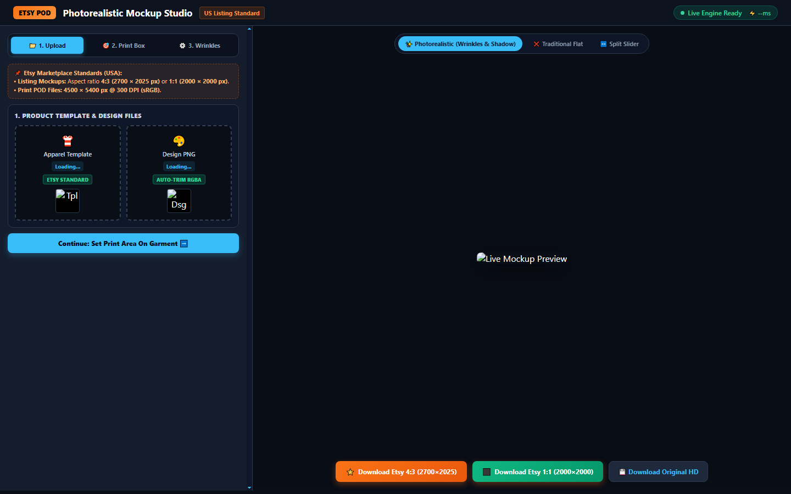
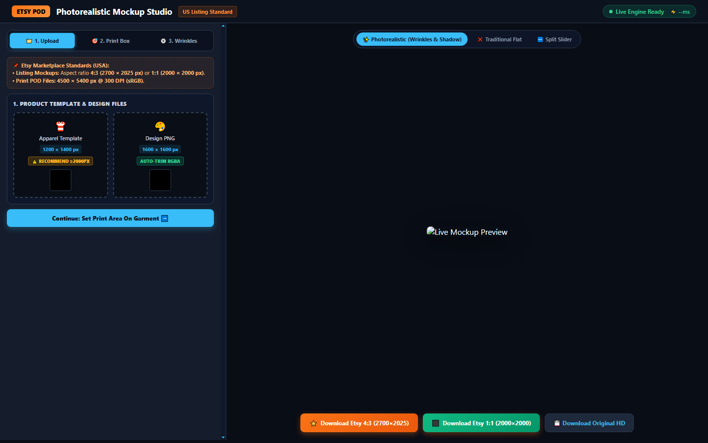

# 👕 MockupForge — Photorealistic POD Mockup Engine & Live Studio

<div align="center">

[](LICENSE)
[](https://www.python.org/)
[]()
[]()
[]()

**An ultra-fast, 100% CPU-based optical mockup engine & interactive web studio simulating Photoshop Smart Object warp, fabric wrinkle displacement, and dual-scale lighting for Print-On-Demand (POD) sellers.**

[Features](#-key-features) • [Visual Showcase](#-visual-showcase) • [Installation](#-installation--quick-start) • [Optical Architecture](#-optical-rendering-architecture) • [Etsy Export](#-etsy-listing-standards) • [Sponsor](#-sponsor-this-project)

<br/>

<a href="https://ko-fi.com/thhoang0903"></a>
<a href="https://buymeacoffee.com/thhoang0903"></a>
<a href="https://paypal.me/thieuhoang2209"></a>

</div>

---

## 💡 Why MockupForge?

Traditional mockup tools often paste flat 2D designs over product photos, resulting in synthetic, low-converting product listings that look clearly "photoshopped." Commercial Smart Object templates require heavy Adobe Photoshop subscriptions or slow cloud APIs.

**MockupForge** runs locally on pure mathematics (OpenCV, NumPy, Pillow) with **zero GPU or cloud dependency**. It delivers photorealistic results in **< 0.15s per image**, automatically bending graphics across real fabric folds while shading crease valleys and highlights naturally.

---

## 📸 Visual Showcase

### Before vs. After: Traditional Flat vs. MockupForge Optical Engine


### Interactive Web Studio


### 4-Point 3D Perspective Box & Live PNG Scale


### Optical Maps: Wrinkle Displacement & Lighting Modulation
<div align="center">
  
  
</div>

---

## ✨ Key Features

1. **Alpha Auto-Trim & Bounding Box Detection:**
   * Automatically scans transparent borders and clips design graphics down to non-empty pixels with anti-aliased safety margins.
   * Fixes common user mistakes where designs are exported with excessive empty transparent canvas.

2. **4-Corner 3D Perspective Transform:**
   * Freely drags 4 corners to fit any garment angle, torso tilt, or flat-lay fold.
   * Preserves native aspect ratio and centers artwork seamlessly.

3. **Macro-Structure Displacement Mapping:**
   * Extracts smooth wrinkle gradients via normalized Sobel filters, discarding pixel grain noise.
   * Remaps coordinate grids with **Lanczos-4 interpolation**, guaranteeing 100% pin-sharp text and graphics.

4. **Multi-Scale Photorealistic Lighting & Shadow:**
   * **Light / White Apparel:** Dual-scale ambient crease ratio (`Local Folds / Background Ambient`) deepens realistic fold shadows by 30–50% without altering fabric color tone.
   * **Dark / Black Apparel:** CLAHE topographical relief simulation creates natural DTG white-underbase sheen and satin fabric reflection.
   * Pure slider control: `0.0` gives flat color; `0.8 - 1.2` delivers studio natural drape; `1.5` produces deep dramatic creases.

5. **1-Click Etsy Marketplace Export:**
   * Instant export in **Etsy 4:3 Gold Standard (2700 × 2025 px)** or **Etsy 1:1 Square (2000 × 2000 px)**.
   * Center-cropped and Lanczos-4 scaled at 96% JPEG quality.

---

## 🛠️ Installation & Quick Start

### 1. Prerequisites
* Python 3.8 or higher.
* Git installed on your system.

### 2. Clone Repository
```bash
git clone https://github.com/thieuhoang2002/mockup-forge.git
cd mockup-forge
```

### 3. Install Dependencies
```bash
pip install -r requirements.txt
```

### 4. Launch Web Studio
* **Windows 1-Click:** Double-click `start_studio.bat`.
* **Cross-platform CLI:**
```bash
python app.py
```
Open your browser and navigate to `http://127.0.0.1:5000`.

---

## 🔬 Optical Rendering Architecture

```
User Garment Template + Design PNG
  │
  ├── 1. Alpha Auto-Trim ──► Crops empty borders with anti-aliased padding
  │
  ├── 2. Bounding Box Fit ──► Fits artwork to print box (Lanczos-4)
  │
  ├── 3. 3D Perspective Warp ──► cv2.getPerspectiveTransform & warpPerspective
  │
  ├── 4. Macro Folds Extraction ──► Gaussian blur (21x21) + Sobel normalized gradients
  │
  ├── 5. Displacement Remap ──► cv2.remap with Lanczos-4 interpolation
  │
  └── 6. Optical Shading & Lighting:
        ├── Light Garment: Ambient Crease Contrast Ratio
        └── Dark Garment: CLAHE Topographical Relief (DTG Underbase)
  │
  ▼
Final Photorealistic Mockup (Etsy 2700x2025 / 2000x2000)
```

---

## 📐 Etsy Listing Standards

MockupForge follows official Etsy US listing requirements:

| Output Type | Dimensions | Aspect Ratio | Format | Target Use Case |
| :--- | :--- | :--- | :--- | :--- |
| **Etsy Hero Listing** | `2700 × 2025 px` | `4:3` | JPEG (Q96) | Primary search thumbnail & desktop listings |
| **Etsy Square Thumbnail** | `2000 × 2000 px` | `1:1` | JPEG (Q96) | Mobile feeds & Etsy app recommendations |
| **Original Master** | Native Source px | Dynamic | JPEG (Q98) | High-resolution zoom & archival storage |

---

## 💖 Sponsor This Project

If MockupForge saves you time or boosts your Print-On-Demand / Etsy sales, please consider supporting continued open-source development!

<div align="center">

<a href="https://ko-fi.com/thhoang0903" target="_blank">
  
</a>
&nbsp;&nbsp;
<a href="https://buymeacoffee.com/thhoang0903" target="_blank">
  
</a>
&nbsp;&nbsp;
<a href="https://paypal.me/thieuhoang2209" target="_blank">
  
</a>

<br/><br/>
**GitHub Sponsors:** [@thieuhoang2002](https://github.com/thieuhoang2002)

</div>

---

## 📄 License

Distributed under the **MIT License**. See `LICENSE` for details.
Free for personal and commercial use in your POD store or design workflows.
