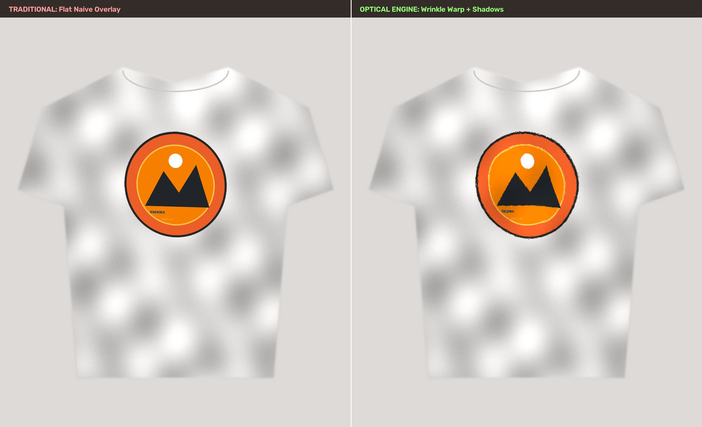
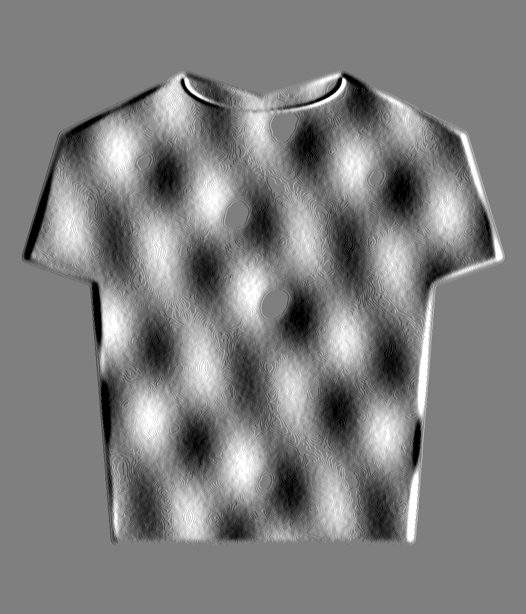
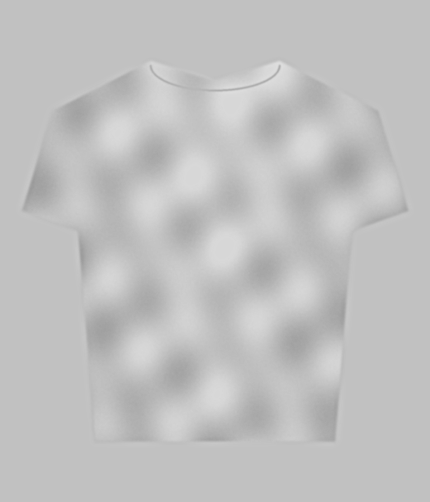

# 👕 MockupForge — Photorealistic POD Mockup Generator & Web Studio

<div align="center">

[](LICENSE)
[](https://www.python.org/)
[]()
[]()
[](https://github.com/thieuhoang2002/mockup-forge/stargazers)
[](https://github.com/thieuhoang2002/mockup-forge/network/members)
[](https://etsy.thhoang.io.vn)

<p align="center">
  <b>Ultra-fast, 100% CPU photorealistic Print-On-Demand (POD) mockup generator & interactive web studio simulating Photoshop Smart Object 3D warp, fabric wrinkle displacement mapping, and dual-scale lighting for Etsy & Shopify sellers.</b>
</p>

[💡 Why MockupForge](#-why-mockupforge) •
[📸 Visual Showcase](#-visual-showcase) •
[✨ Key Features](#-key-features) •
[📊 Comparison Matrix](#-comparison-matrix) •
[🛠️ Quick Start](#-installation--quick-start) •
[🔬 Optical Architecture](#-optical-rendering-architecture) •
[📐 Marketplace Standards](#-etsy--ecommerce-listing-standards) •
[❓ FAQ](#-frequently-asked-questions-faq) •
[☕ Support](#-sponsor-this-project)

<br/>

<a href="https://ko-fi.com/thhoang0903"></a>
<a href="https://buymeacoffee.com/thhoang0903"></a>
<a href="https://paypal.me/thieuhoang2209"></a>

</div>

---

## 💡 Why MockupForge?

Traditional online mockup generators simply paste flat 2D graphics over apparel photos, resulting in synthetic, low-converting product listings that look unmistakably "photoshopped." Commercial Smart Object templates require expensive Adobe Photoshop subscriptions, complex layer setups, or slow cloud SaaS tools ($15–$30/mo).

**MockupForge** runs locally on pure computer vision mathematics (OpenCV, NumPy, Pillow) with **zero GPU, zero cloud dependency, and zero subscriptions**. It delivers studio-grade photorealistic results in **< 0.15s per image**, automatically bending graphics across real fabric folds while dynamically shading crease valleys and highlights.

---

## 📸 Visual Showcase

### Before vs. After: Traditional Flat Overlay vs. MockupForge Optical Engine


### Optical Maps: Wrinkle Displacement & Lighting Modulation
<div align="center">
  
  
</div>

---

## 📊 Comparison Matrix

| Feature | MockupForge (Free & Open Source) | Adobe Photoshop (Smart Objects) | Placeit / Smartmockups SaaS | Canva / Flat Paste Tools |
| :--- | :---: | :---: | :---: | :---: |
| **Pricing** | **100% Free Forever** | $239.88 / year | $120–$360 / year | Free / $120 / year |
| **Rendering Speed** | ⚡ **< 0.15s (Instant)** | 🐌 5–15s (Manual reload) | ⏳ 3–8s (Cloud queue) | ⚡ Fast (No realism) |
| **Hardware Required** | 💻 **Any standard CPU** | High RAM & Discrete GPU | Web browser only | Web browser |
| **Real Fabric Displacement** | ✅ **Sobel Gradient Remap** | ✅ Displacement Filter (.psd) | ⚠️ Generic cloud mesh | ❌ None (Flat 2D) |
| **Dark Garment DTG Underbase**| ✅ **CLAHE Topographical** | ⚠️ Manual layer tweaking | ⚠️ Hit or miss | ❌ None |
| **Batch CLI Automation** | ✅ **Native Python Script** | ⚠️ Complex JSX Actions | ❌ Extra API pricing | ❌ None |
| **Data Privacy** | 🔒 **100% Local (Offline)** | Local | ❌ Assets on cloud servers| ❌ Assets on cloud servers|

---

## ✨ Key Features

1. **Alpha Auto-Trim & Bounding Box Detection:**
   * Automatically scans transparent borders and tightly clips design graphics down to non-empty pixels with anti-aliased safety margins.
   * Eliminates user frustration where artwork is exported with excessive empty transparent canvas from Illustrator, Photoshop, or Canva.

2. **4-Corner 3D Perspective Transform:**
   * Interactive quad-point handles allow you to tilt, rotate, and stretch artwork to match any garment angle, torso posture, or flat-lay drape.
   * Automatically preserves native aspect ratio and centers artwork seamlessly.

3. **Macro-Structure Displacement Mapping:**
   * Extracts smooth wrinkle gradients via normalized Sobel gradient kernels, filtering out high-frequency fabric grain noise.
   * Coordinate remapping executed via **Lanczos-4 interpolation**, guaranteeing pin-sharp typography, vector outlines, and fine line-art.

4. **Multi-Scale Photorealistic Lighting & Shadow:**
   * **Light / White Apparel:** Dual-scale ambient crease ratio (`Local Folds / Background Ambient`) deepens realistic fold shadows by 30–50% without muddying fabric color tones.
   * **Dark / Black Apparel:** CLAHE topographical relief simulation generates natural Direct-to-Garment (DTG) white-underbase sheen and satin fabric reflection.
   * Intuitive slider control: `0.0` yields flat color; `0.8 - 1.2` delivers studio natural drape; `1.5` creates deep dramatic creases.

5. **1-Click Etsy & E-Commerce Export:**
   * Instant export in **Etsy 4:3 Gold Standard (2700 × 2025 px)** and **Etsy 1:1 Square (2000 × 2000 px)**.
   * Automatically center-cropped and Lanczos-4 scaled at 96% JPEG quality for blazing-fast loading speeds on mobile and desktop search feeds.

---

## 🛠️ Installation & Quick Start

### 1. Prerequisites
* **Python 3.8+** installed ([Download Python](https://www.python.org/downloads/)).
* **Git** installed on your system.

### 2. Clone Repository
```bash
git clone https://github.com/thieuhoang2002/mockup-forge.git
cd mockup-forge
```

### 3. Install Dependencies
```bash
pip install -r requirements.txt
```

### 4. Launch Interactive Web Studio
* **Windows (1-Click Launch):** Double-click `start_studio.bat`.
* **Cross-Platform CLI (Windows, macOS, Linux):**
```bash
python app.py
```
Open your browser and navigate to **`http://127.0.0.1:5000`**.

### 5. Automated Batch Demo
Want to see instant sample mockups generated in bulk?
```bash
python run_demo.py
```
Check the generated outputs in the `output/` directory!

---

## 🔬 Optical Rendering Architecture

```
User Garment Template + Design Artwork (PNG)
  │
  ├── 1. Alpha Auto-Trim ──────────► Strips empty canvas borders with anti-aliasing
  │
  ├── 2. Bounding Box Fit ─────────► Scales artwork to target print box (Lanczos-4)
  │
  ├── 3. 3D Perspective Warp ──────► cv2.getPerspectiveTransform & cv2.warpPerspective
  │
  ├── 4. Macro Folds Extraction ───► Gaussian blur (21x21) + Sobel normalized gradients
  │
  ├── 5. Displacement Remap ───────► cv2.remap with Lanczos-4 sub-pixel interpolation
  │
  └── 6. Optical Shading & Lighting:
        ├── Light Garment: Ambient Crease Contrast Ratio (Shadow Depth)
        └── Dark Garment: CLAHE Topographical Relief (DTG Underbase Sheen)
  │
  ▼
Final Photorealistic Mockup (Etsy 2700x2025 / Shopify 2000x2000 / Master Native)
```

---

## 📐 Etsy & E-Commerce Listing Standards

MockupForge follows official Etsy and Shopify listing optimization guidelines:

| Output Preset | Resolution | Aspect Ratio | Format | Target Recommendation |
| :--- | :--- | :---: | :---: | :--- |
| **Etsy Hero Listing** | `2700 × 2025 px` | `4:3` | JPEG (Q96) | Primary search thumbnail & desktop gallery listings |
| **Etsy Square Thumbnail** | `2000 × 2000 px` | `1:1` | JPEG (Q96) | Mobile app feeds, Instagram shopping, & Shopify products |
| **Original Master** | Native Source px | Dynamic | JPEG (Q98) | High-resolution archival master & multi-angle zoom shots |

---

## ❓ Frequently Asked Questions (FAQ)

<details>
<summary><b>1. How does MockupForge replicate Photoshop Smart Object displacement without Photoshop?</b></summary>
<br>
MockupForge uses an optical computer vision pipeline powered by OpenCV and NumPy. It analyzes the garment template's grayscale luminosity values, generates Sobel gradient maps corresponding to real surface fabric normal vectors, and applies <code>cv2.remap</code> with Lanczos-4 interpolation. This mathematically replicates Adobe Photoshop's <i>Displace</i> filter and Smart Object mesh warping with zero external software required.
</details>

<details>
<summary><b>2. Is MockupForge free for commercial Print-on-Demand (POD) and e-commerce stores?</b></summary>
<br>
Yes! MockupForge is released under the permissive <b>MIT License</b>. You can freely use it to generate unlimited commercial mockups for your Etsy, Shopify, Amazon Merch, Printify, Printful, or WooCommerce listings without royalties or attribution requirements.
</details>

<details>
<summary><b>3. Do I need a high-end graphics card (GPU) or cloud credits to run it?</b></summary>
<br>
No GPU or cloud connection is required. MockupForge is engineered specifically for ultra-low latency CPU execution. A standard multi-core laptop CPU renders a 4K photorealistic mockup in under <b>0.15 seconds</b>.
</details>

<details>
<summary><b>4. Can I automate bulk mockup generation for hundreds of designs?</b></summary>
<br>
Yes. Because MockupForge's core engine is encapsulated in <code>engine.py</code>, you can script bulk rendering using standard Python loops. Check <code>run_demo.py</code> for an example of automated headless rendering.
</details>

<details>
<summary><b>5. Can I use templates other than t-shirts (e.g., hoodies, sweatshirts, tote bags, mugs)?</b></summary>
<br>
Yes. The 4-corner perspective tool and displacement engine work with any flat-lay or model apparel photograph, including hoodies, sweatshirts, tank tops, tote bags, pillows, and canvas wall art.
</details>

---

## 🌐 Looking to Scale Your Etsy Operations & Sales?

Check out our companion open-source & web tools:
- 🛡️ **[EtsyVault](https://github.com/thieuhoang2002/EtsyVault)** — Free, local-first backup & disaster recovery tool for Etsy sellers.
- 👉 **[Etsy Command Center](https://etsy.thhoang.io.vn)** — *All-in-One Operations, Finance & Automation Suite for Etsy Power Sellers*.

---

## 💖 Sponsor This Project

If MockupForge saves you time or boosts your Print-On-Demand / Etsy sales, please consider supporting continued open-source development!

<div align="center">

<a href="https://ko-fi.com/thhoang0903" target="_blank">
  
</a>
&nbsp;&nbsp;
<a href="https://buymeacoffee.com/thhoang0903" target="_blank">
  
</a>
&nbsp;&nbsp;
<a href="https://paypal.me/thieuhoang2209" target="_blank">
  
</a>

<br/><br/>
**GitHub Sponsors:** [@thieuhoang2002](https://github.com/thieuhoang2002)

</div>

---

## 📄 License

Distributed under the **MIT License**. See [`LICENSE`](LICENSE) for details.
Free for personal and commercial use in your POD store or design workflows.
